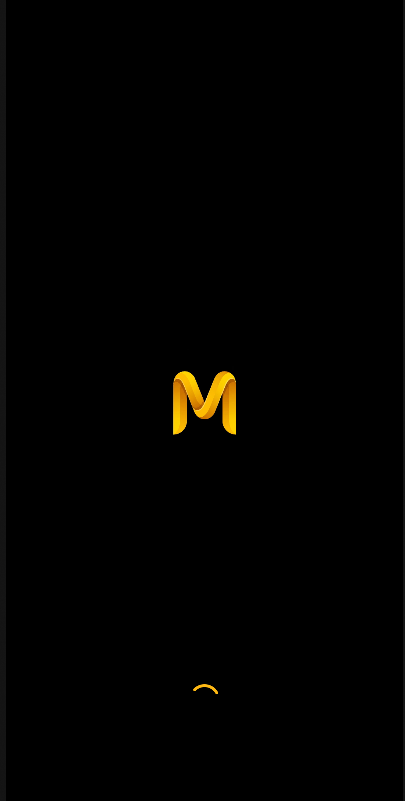
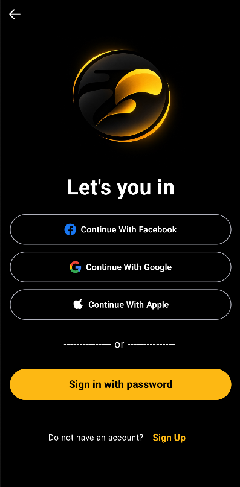
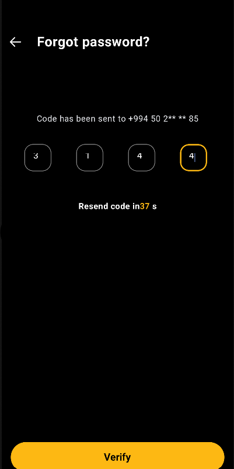
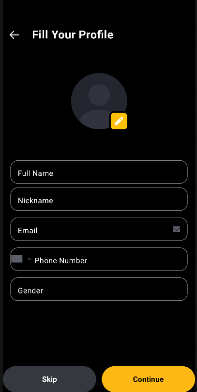
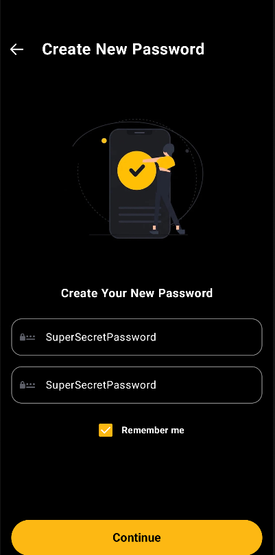

# MovEra

Android mobile application built with Kotlin and Jetpack Compose.

## Screens

| Start | Splash | Lets In | Login |
| :---: | :---: | :---: | :---: |
|  |  |  |  |
| Sign Up | Forgot Password | Fill Profile | Create Account |
|  |  |  |  |